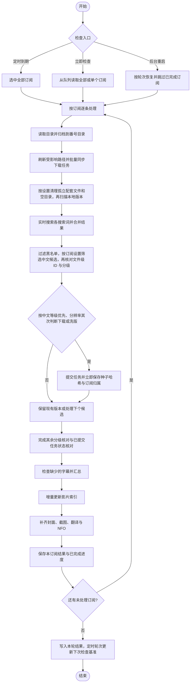
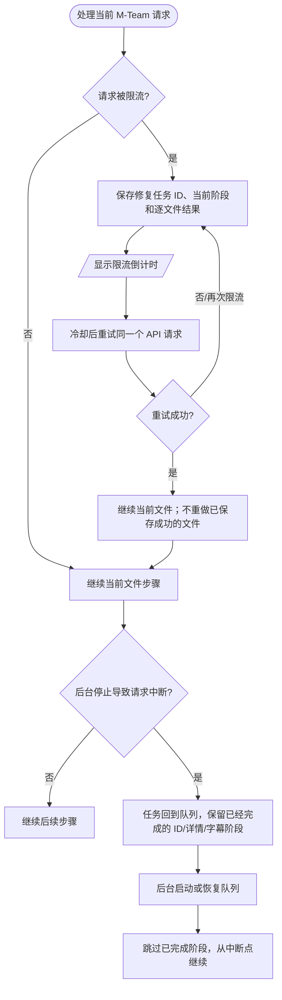

# 检查与修复数据流程图

符号约定：圆角框表示开始/结束，平行四边形表示输入/输出，矩形表示处理，菱形表示条件判断。分支箭头标注“是/否”。

## 定时检查与立即检查

- 状态栏按轮次显示运行、限流、停止或完成，排队数量单独显示。
- 限流等待结束后重试当前 M-Team 请求，保留已经取得的搜索结果。恢复时使目录和下载器快照失效，后续操作按需重新核对。
- 停止请求携带当前轮次 ID。正在进行的文件操作收尾并保存后停止，限流等待和请求间隔也可停止。后续任务继续遵守已有的 M-Team 冷却期限。

## 修复数据

```mermaid
flowchart TD
    A([开始]) --> B[/选择“修复数据”范围：当前订阅全部视频/]
    B --> C{是否已有重叠修复任务?}
    C -- 是 --> C1[/返回已有任务或提示等待/]
    C -- 否 --> D[创建 repair job 并写入后台队列]
    D --> E[/显示排队状态/]
    E --> F[调度器取出 repair_data 任务]
    F --> G{订阅存在且 M-Team 令牌已配置?}
    G -- 否 --> G1[记录任务失败原因]
    G -- 是 --> H[扫描当前订阅目录]
    H --> I{是否选定单个文件?}
    I -- 是 --> I1{路径在订阅目录内、文件存在且番号一致?}
    I1 -- 否 --> I2[拒绝任务，不访问该文件]
    I1 -- 是 --> J[仅归档所选视频及配套文件，记录迁移后的路径]
    I -- 否 --> J0[核对 qBittorrent 路径并将已有影片及配套文件归档到番号目录]
    J --> J1[重新扫描并冻结当前范围内的目标文件]
    J0 --> J1
    J1 --> K[准备全部目标文件逐文件 ID 核对]
    K --> L[一次读取 qBittorrent 任务快照]
    L --> M[按任务文件清单的映射后完整路径精确匹配目标视频]
    M --> N{Tracker 是否包含 m-team 或 manfuz?}
    N -- 否 --> O[忽略该种子]
    N -- 是 --> P{文件路径是否精确匹配目标?}
    P -- 否 --> O
    P -- 是 --> Q[读取种子注释中的 M-Team ID]
    Q --> R{注释中是否有有效 ID?}
    R -- 否 --> O
    R -- 是 --> S[将该 ID 记入对应目标文件候选集合]
    O --> T{还有候选种子?}
    S --> T
    T -- 是 --> M
    T -- 否 --> U[读取下一目标文件的候选 ID]
    U --> V{同一文件是否出现多个不同 ID?}
    V -- 是 --> V1[保留原数据并标记冲突；跳过此文件]
    V -- 否 --> W{有唯一匹配 ID?}
    W -- 是 --> X1[新增或修正逐文件 ID；保存 hash]
    W -- 否 --> X2{是否已有逐文件 ID?}
    X2 -- 是 --> X3[沿用原逐文件 ID]
    X2 -- 否 --> X4[记录无 ID 并跳过此文件]
    X1 --> W1[保存此文件 ID 结果]
    X3 --> W1
    X4 --> W1
    V1 --> W1
    W1 --> W2{还有未处理目标文件?}
    W2 -- 是 --> U
    W2 -- 否 --> W3[保存全部 ID 核对结果]
    W3 --> X[按文件逐一刷新详情]
    X --> Y{文件此前已成功刷新?}
    Y -- 是 --> Y1[复用该文件已保存的刷新结果]
    Y -- 否 --> Y2{同一 ID 的详情本任务已缓存?}
    Y2 -- 是 --> AC
    Y2 -- 否 --> Z[强制请求该 ID 的 M-Team 详情]
    Z --> AA{详情女优关键字匹配当前订阅?}
    AA -- 否 --> AB[保留旧信息并记录失败]
    AA -- 是 --> AC[解析分辨率、中文等级、编码、副标题及 MediaInfo]
    AC --> AD[替换缓存；详情未提供 MediaInfo 时清空旧值]
    AD --> AE{刷新后中文等级是“中文字幕”?}
    Y1 --> AE
    AE -- 否 --> AF[不查找/下载外挂字幕]
    AE -- 是 --> AG{视频旁是否已有配套字幕?}
    AG -- 是 --> AH[保留现有字幕，不重复下载]
    AG -- 否 --> AI[忽略旧的未找到/失败冷却，按 M-Team ID 查询字幕]
    AI --> AJ{找到可下载中文字幕?}
    AJ -- 否 --> AK[记录字幕未找到；已刷新的影片信息保留]
    AJ -- 是 --> AL[选择下载量最高字幕并保存为 视频名.MT.语言.扩展名]
    AL --> AM[更新字幕状态与本地字幕列表]
    AF --> AN[保存当前文件处理结果]
    AH --> AN
    AK --> AN
    AM --> AN
    AB --> AN
    AN --> AO{还有未处理的目标文件?}
    AO -- 是 --> X
    AO -- 否 --> AP[刷新影片索引、SQLite 和字幕汇总目录]
    AP --> AP1[刷新 DMM 资料与图片来源]
    AP1 --> AP2{服务器确认图片未变，或返回内容与本地相同?}
    AP2 -- 是 --> AP3[复用本地图片，保留现有海报]
    AP2 -- 否 --> AP4[补齐缺失图片或写入已验证的新版；失败时保留旧图]
    AP3 --> AP5[补齐或更新需要重裁的海报，更新 NFO]
    AP4 --> AP5
    AP5 --> AP6[保存当前番号的处理结果，更新影片列表的状态]
    AP6 --> AP7{还有待处理图片的番号?}
    AP7 -- 是 --> AP1
    AP7 -- 否 --> AQ[/输出新增/修正 ID、刷新数、字幕和图片保存、跳过及失败统计/]
    AQ --> AR[写入任务完成状态和日志]
    AR --> AS([结束])
    G1 --> AT[写入任务失败状态]
    I2 --> AT
    AT --> AS
```

## 限流与恢复

## 处理规则

- 全订阅修复先对全部视频完成 ID 核对，再开始详情刷新；单视频修复只允许处理请求中的准确路径，不扩展到同番号的其他文件。
- 精确匹配要求种子实际文件路径映射后与本地目标完整路径一致。Tracker 不符、路径不符或多个种子产生冲突时不猜测；未匹配时只沿用数据库中的逐文件 ID，不借用番号级或下载记录 ID。
- 同一 ID 的详情在本次修复中缓存复用。详情失败或女优不匹配时保留旧信息；已成功刷新的信息不会因为字幕下载失败而回滚。
- 字幕只在刷新结果明确为“中文字幕”时处理。已有配套字幕时保持现状；缺少字幕才查询下载；内嵌中文与非中文不进入字幕下载分支。
- 完成后重新扫描并写入本地视频 SQLite 索引，更新字幕标记；设置了字幕汇总目录时按现有 `.MT.` 来源规则汇总字幕。
- SQLite 为每个视频文件单独保存 `cover_url`。详情刷新优先使用 `imageList` 首图，缺少首图时从详情描述中提取。点击本地影片列表的缩略图可查看封面和截图。
- 如服务器支持 `ETag` 或 `Last-Modified`，修复时用条件请求核对封面和截图；返回 HTTP 304 时不下载图片正文。首次核对旧图片或服务器未提供校验标记时，取回图片并比对内容，只有新内容才覆盖现有文件。
- 修复任务独立于定时检查状态，不搜索新影片、不提交种子、不触发洗版，也不删除视频或配套文件。
